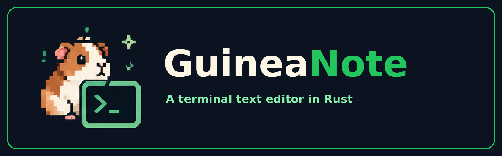
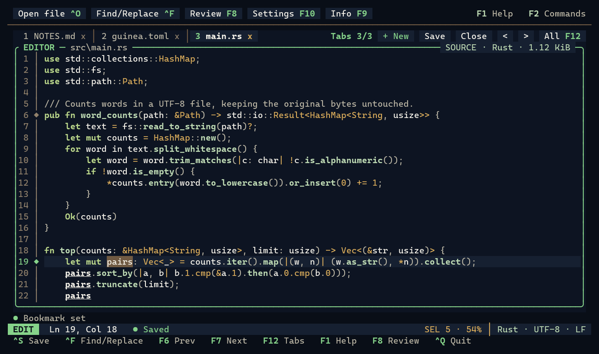
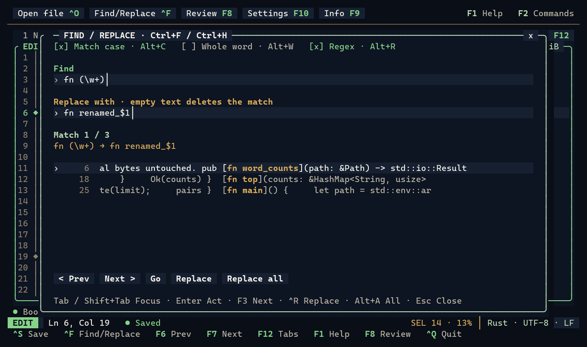
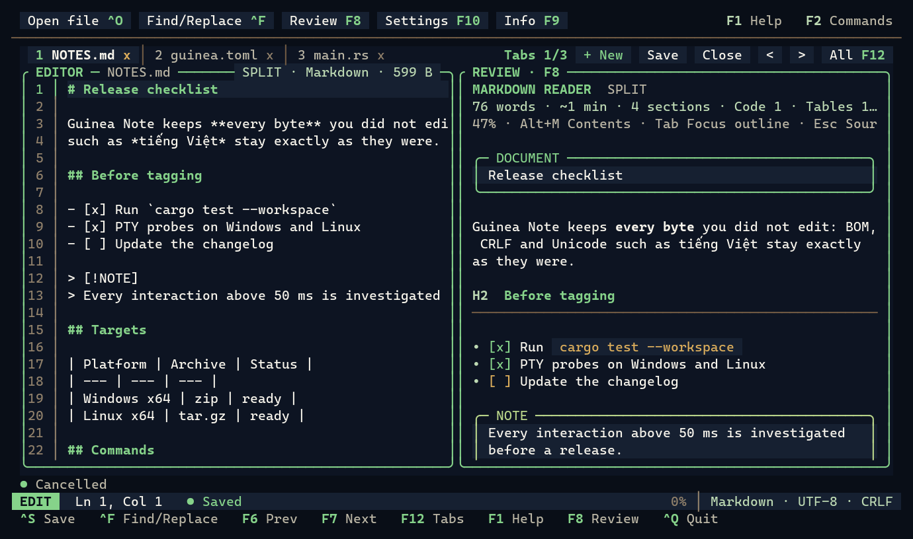
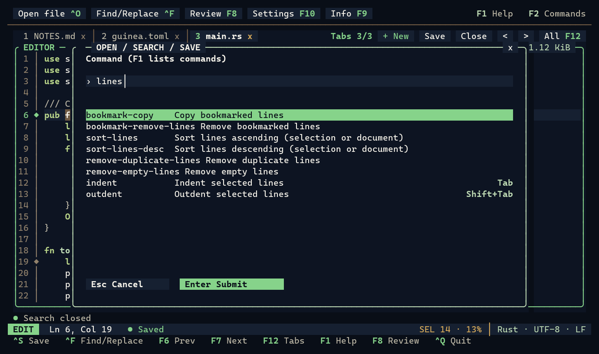
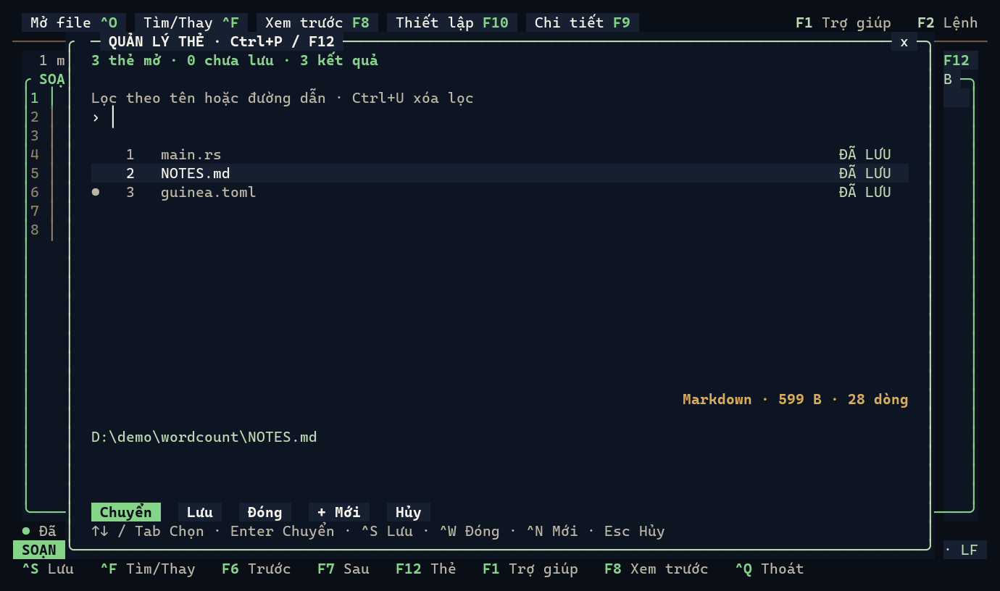

<p align="center">
  
</p>

<p align="center">
  <a href="https://github.com/cmm-cmm/GuineaNote/releases"></a>
  <a href="LICENSE"></a>
  
  
</p>

# Guinea Note

**Guinea Note** is a Notepad++-style text editor for the terminal, written in
Rust. It opens files in tabs and gives you one Find/Replace panel with regular
expressions, line tools, bookmarks and session restore. Saves keep your bytes
exactly as they were: BOM, LF/CRLF/mixed newlines and every untouched
character stay the same.

It is built with [Ratatui](https://ratatui.rs),
[Crossterm](https://github.com/crossterm-rs/crossterm) and
[Ropey](https://github.com/cessen/ropey). The interface is in English and
Vietnamese.

> **Status: 0.1.x preview.** Releases target **Windows x64** and **Linux x64**
> (static binaries for any distribution). macOS is not released.

<p align="center">
  
</p>

## Contents

- [Features](#features)
- [Screenshots](#screenshots)
- [Installation](#installation)
- [Quick start](#quick-start)
- [Keyboard essentials](#keyboard-essentials)
- [Working with files](#working-with-files)
- [Find and Replace](#find-and-replace)
- [Previews](#previews)
- [Configuration](#configuration)
- [Agent access (CLI and MCP)](#agent-access-cli-and-mcp)
- [Platforms and limits](#platforms-and-limits)
- [Documentation](#documentation)
- [Contributing](#contributing)
- [License](#license)

## Features

- **Tabs like Notepad++.** A one-row tab bar, a tab manager (F12 / Ctrl+P) to
  filter, switch, save and close tabs, and session restore of open files,
  carets and the active tab.
- **One Find/Replace panel** (Ctrl+F / Ctrl+H). Match case, whole word and
  linear-time regular expressions with `$1` / `${name}` replacements. Also
  Mark All, bookmarks for marked lines, and Replace all as a single Undo step.
- **Line and text tools** in the F2 action list:
  - sort ascending or descending;
  - remove duplicate or empty lines, trim trailing whitespace;
  - UPPER / lower / Title case;
  - line comments for each language.

  Indent, duplicate and move lines from the keyboard.
- **Exact files.** Strict UTF-8 with BOM and newline style preserved, atomic
  saves, conflict checks when another program changed the file, and
  checksummed crash-recovery drafts.
- **Responsive on big files:**
  - long lines are indexed and large tools run in the background;
  - keys typed meanwhile are queued, never dropped;
  - Esc cancels a large tool;
  - Quit or Close pressed during a save waits for the save.
- **Readable previews** for Markdown (with a contents sidebar), JSON, CSV/TSV,
  XML, TOML, YAML, INI/ENV and notebooks, as a split view or a linked
  read-only tab.
- **Keyboard first.** Every mouse action has a key, and the key labels on
  screen come from the keymap itself. Mouse support is optional.
- **Opt-in Agent access.** A JSON CLI and an MCP server let a local coding
  agent read and edit open documents safely.

## Screenshots

<table>
  <tr>
    <td width="50%"></td>
    <td width="50%"></td>
  </tr>
  <tr>
    <td><b>Find/Replace</b> with regular expressions and <code>$1</code> replacements (Ctrl+F, Alt+R)</td>
    <td><b>Split preview</b> of Markdown beside its source (F8)</td>
  </tr>
  <tr>
    <td></td>
    <td></td>
  </tr>
  <tr>
    <td><b>F2 action list</b>: every action, its key, or why it is unavailable</td>
    <td><b>Vietnamese interface</b> and the tab manager (F12)</td>
  </tr>
</table>

Screenshots are rendered from the real editor in a terminal
(`python -X utf8 scripts/readme_screenshots.py`).

## Installation

### Download a release

Every [release](https://github.com/cmm-cmm/GuineaNote/releases) has one archive
per platform, plus `SHA256SUMS` and `release-manifest.json`. Each archive
contains:
- `guinea`, the editor;
- `guineanote-agent` and `guineanote-mcp`, for Agent access;
- `LICENSE` and `THIRD_PARTY_NOTICES.txt`.

**Linux x64** (static: Debian 11+, Ubuntu 22.04+, Alpine and others):

```sh
curl -LO https://github.com/cmm-cmm/GuineaNote/releases/download/v0.1.1/guinea-0.1.1-x86_64-unknown-linux-musl.tar.gz
curl -LO https://github.com/cmm-cmm/GuineaNote/releases/download/v0.1.1/SHA256SUMS
sha256sum --ignore-missing -c SHA256SUMS
tar -xzf guinea-0.1.1-x86_64-unknown-linux-musl.tar.gz
install -m 755 guinea-0.1.1-x86_64-unknown-linux-musl/guinea ~/.local/bin/
```

**Windows x64** (PowerShell; no Visual C++ redistributable needed):

```powershell
Invoke-WebRequest https://github.com/cmm-cmm/GuineaNote/releases/download/v0.1.1/guinea-0.1.1-x86_64-pc-windows-msvc.zip -OutFile guinea.zip
Get-FileHash -Algorithm SHA256 guinea.zip    # compare with SHA256SUMS
Expand-Archive guinea.zip -DestinationPath "$env:LOCALAPPDATA\GuineaNote"
# then add $env:LOCALAPPDATA\GuineaNote\guinea-0.1.1-x86_64-pc-windows-msvc to your PATH
```

The binaries are not code-signed yet, so SmartScreen may warn about a browser
download. winget (`cmm-cmm.GuineaNote`) and npm (`npx guinea-note`) packages
are planned; see the [release plan](docs/RELEASE.md).

### Install with Cargo

With Rust 1.98 or newer (and the MSVC build tools on Windows), Cargo builds
and installs a tagged release straight from GitHub:

```sh
cargo install --git https://github.com/cmm-cmm/GuineaNote --tag v0.1.1 --locked guineanote
# Agent access (optional): guineanote-agent and guineanote-mcp
cargo install --git https://github.com/cmm-cmm/GuineaNote --tag v0.1.1 --locked guinea-agent
```

The binaries go to `~/.cargo/bin` (`%USERPROFILE%\.cargo\bin` on Windows).
They use your toolchain's defaults: on Linux they link the system glibc, and
on Windows the Visual C++ runtime is linked dynamically (the release archives
link it statically). Upgrade by running the same command with a newer tag and
`--force`; remove with `cargo uninstall guineanote guinea-agent`.

### Build from source

You need Rust 1.98 or newer; Windows also needs the MSVC build tools.

```sh
git clone https://github.com/cmm-cmm/GuineaNote.git
cd GuineaNote
# Windows: the C runtime is linked statically (.cargo/config.toml)
cargo build --workspace --release --locked
# Linux: static musl binaries that run on any distribution
rustup target add x86_64-unknown-linux-musl   # plus musl-tools on Debian/Ubuntu
cargo build --workspace --release --locked --target x86_64-unknown-linux-musl
```

Copy `guinea` (and `guineanote-agent` / `guineanote-mcp` if you want Agent
access) onto your `PATH`. Running the editor needs neither Rust nor Node.js.

## Quick start

```sh
guinea notes.md                # open a file; a missing path is created on save
guinea a.txt b.txt             # one tab per file
guinea                         # reopen the previous session (or the welcome screen)
guinea --language vi notes.md  # Vietnamese interface
guinea --readonly server.log   # no edits or saves
guinea --config guineanote.example.toml
guinea --help
```

Inside the editor:
- **F1** shows the keyboard guide.
- **F2** lists every action with its key, or with the reason it is unavailable
  right now.
- **Ctrl+S** saves and **Ctrl+Q** quits.

Folders are not opened; use Ctrl+O to pick a file. The recommended terminal
size is 100×28 or larger, and the layout still works down to small windows.

## Keyboard essentials

| Keys | Action |
| --- | --- |
| Ctrl+N / Ctrl+O / Ctrl+S | New tab / open (file picker) / save |
| Alt+S or Ctrl+Shift+S | Save to a new path |
| Ctrl+W / Ctrl+Q | Close tab / quit (unsaved changes are confirmed) |
| Ctrl+Z / Ctrl+Y | Undo / redo |
| Ctrl+A / Ctrl+C / Ctrl+X / Ctrl+V | Select all / copy / cut / paste (system clipboard) |
| Ctrl+Left / Ctrl+Right, Ctrl+Backspace / Ctrl+Delete | Move / delete by word |
| Tab / Shift+Tab, Ctrl+D, Alt+Up / Alt+Down | Indent / outdent, duplicate, move lines |
| Ctrl+F / Ctrl+H, F3 | Find/Replace panel, next match |
| Ctrl+L or Ctrl+G | Go to line[:column] |
| Ctrl+F2, Alt+F2 / Shift+F2 | Toggle bookmark, next / previous bookmark |
| F6 / F7, Ctrl+PageUp / Ctrl+PageDown | Previous / next tab |
| F12 or Ctrl+P | Tab manager |
| F8 | Split preview or linked review tab |
| F9 / F10 | File details / Settings (language) |
| F11 or Shift+F11 | Focus mode |
| F1 / F2 | Keyboard guide / action list |
| Esc | Close a dialog, cancel a large tool |

Typing groups into one Undo step until you pause or move the caret, and Enter
keeps the indentation. Ctrl+C or Ctrl+X without a selection copies or cuts the
whole line.

The complete keymap, terminal conflicts and alternatives are in
[docs/KEYBOARD_SHORTCUTS.md](docs/KEYBOARD_SHORTCUTS.md).

**Mouse** (optional):
- click tabs, buttons and the text;
- drag or Shift-click to select;
- the wheel scrolls, and Shift+wheel scrolls sideways;
- middle-click closes a tab.

## Working with files

- **Encoding and newlines.** Only UTF-8 is edited. The BOM and the original
  LF/CRLF/mixed newline bytes are preserved, and Enter uses CRLF only in files
  that use CRLF throughout.
- **Refused files.** Invalid encodings, binary/NUL content and symlinked files
  are refused rather than damaged.
- **Safe saves.**
  - Saves are atomic.
  - If another program changed the file, saving stops with a conflict. You can
    then reload (F2 → `reload`), save to a new path or cancel.
  - Saving runs in the background, so you can keep typing.
- **Crash recovery.** Unsaved tabs are checkpointed about once per second
  into a private local store and come back as drafts after a crash. Drafts
  never overwrite the source file. Set `recovery = false` to turn this off.
- **Session restore.** A normal exit records the open file tabs, each caret
  and the active tab. Running `guinea` without files reopens them. Set
  `session = false` to turn this off.
- **Large files.** Opening a file above 10 MiB asks first. Long lines, file
  I/O, full-document search and big line tools run on background workers.
- **Undo history.** History keeps up to 2,048 steps and 64 MiB of edit data.
  Old steps are trimmed with a notice, and F9 shows the counts.

Details: [file safety](docs/FILE_SAFETY.md) and
[editor behavior](docs/EDITOR_BEHAVIOR.md).

## Find and Replace

Ctrl+F and Ctrl+H open the same panel, with both the Find and Replace fields
visible.
- **Options:** Alt+C toggles match case, Alt+W whole word and Alt+R regular
  expressions. Regex uses the linear-time Rust `regex` engine, and
  replacements accept `$1` and `${name}`.
- **Navigation:** Enter / Shift+Enter jump to the next / previous match.
  Results are listed with line numbers, 200 per page.
- **Replace:** Ctrl+R replaces the current match and Alt+A replaces all. Each
  operation is a single Undo step.
- **Background:** scanning and replacing run on cancellable workers. Closing
  the panel cancels work that has not been applied.

Read-only documents and documents an Agent is editing cannot be replaced. See
the [search guide](docs/SEARCH_REPLACE.md).

## Previews

F8 shows a formatted, read-only preview beside the source (split) or in a
linked review tab. Esc returns to the source, and the preview follows
your edits.
- **Markdown:** headings, tables, task lists, callouts, numbered code blocks
  and a contents sidebar (Alt+M).
- **Data files:** JSON / JSONL / JSON5, CSV / TSV, XML / SVG, TOML, YAML
  (multi-document), INI / ENV / properties and Jupyter notebooks (shown, never
  run).
- **Any other UTF-8 file:** a syntax-colored source review.

Previews never write formatted content back to the file. See
[formats](docs/FORMATS.md).

## Configuration

Settings come from a TOML file passed with `--config` (see
[guineanote.example.toml](guineanote.example.toml)):

```toml
language = "en"                  # "en" or "vi"; --language overrides it
tab_width = 4                    # 1-16
large_file_warning_bytes = 10485760
syntax = true
mouse = true
basic_colors = false             # 256-color theme for terminals without true color
ansi_colors = false              # 16-color palette (auto for TERM=linux/vt100)
clipboard = "auto"               # "auto", "system", "osc52" or "internal"
recovery = true
session = true
```

- **Language.** F10 opens Settings to switch the language and remembers it.
  Preferences are saved to `%APPDATA%\GuineaNote\preferences.toml` on Windows,
  or `$XDG_CONFIG_HOME/guineanote/preferences.toml` (default
  `~/.config/guineanote/`) on Linux.
- **Clipboard.**
  - Locally, the system clipboard is used: the Windows API, or `wl-clipboard`,
    `xclip` or `xsel` on Linux.
  - Over SSH the editor falls back to an internal clipboard. OSC 52 is
    opt-in (`clipboard = "osc52"`).
  - `GUINEANOTE_CLIPBOARD` overrides the mode for one run.
- **Colors.** The theme uses true color where the terminal supports it.
  `NO_COLOR` is honored, and no Nerd Font is needed.

## Agent access (CLI and MCP)

Agent access is off unless you start the editor with `--agent`. Add
`--agent-write` to allow edits and saves. Sensitive paths such as `.env` stay
blocked unless you add `--agent-secrets`.

```sh
guinea --agent --agent-write notes.md
guineanote-agent sessions          # JSON CLI
guineanote-mcp                     # MCP stdio server for an MCP host
```

Agents read live, unsaved buffers. Their changes apply only at the document
revision they planned against. While an Agent works on a document, that tab
and its linked review are read-only to you and marked **AI**; other tabs stay
editable. See the [Agent guide](docs/AGENT_USAGE.md) (Vietnamese) and
[implementation notes](docs/AGENT_IMPLEMENTATION.md).

## Platforms and limits

| Platform | Status |
| --- | --- |
| Windows x64 (Windows Terminal, conhost) | Released; verified on Windows 11 with ConPTY |
| Linux x64 (static musl) | Released; verified in a Debian 12 container, runs on Debian 11/12, Ubuntu 22.04, Alpine 3.20 |
| macOS | Not released and not verified |
| ARM64, real Linux terminal emulators, Wayland clipboard, SSH/tmux | Not yet verified |

- **Responsiveness.** Every measured interaction above 50 ms is investigated
  before a release; the targets are p50 ≤ 10 ms, p95 ≤ 20 ms and
  p99 ≤ 50 ms ([latency targets](docs/performance/INTERACTION_LATENCY_TARGETS.md)).
- **Memory.** Files live in memory (Ropey), and Undo history and search
  snapshots add to that.
- **Not included:** bounded-memory editing of huge files, LSP, plugins, Git
  integration and folder browsing (removed on purpose to keep the editor
  simple).

## Documentation

| Topic | Document |
| --- | --- |
| Keyboard shortcuts (keymap v1) | [docs/KEYBOARD_SHORTCUTS.md](docs/KEYBOARD_SHORTCUTS.md) |
| Editing rules | [docs/EDITOR_BEHAVIOR.md](docs/EDITOR_BEHAVIOR.md) |
| Find/Replace | [docs/SEARCH_REPLACE.md](docs/SEARCH_REPLACE.md) |
| File safety and recovery | [docs/FILE_SAFETY.md](docs/FILE_SAFETY.md) |
| Preview formats | [docs/FORMATS.md](docs/FORMATS.md) |
| Terminal workflow and limits | [docs/TERMINAL_WORKFLOW.md](docs/TERMINAL_WORKFLOW.md) |
| Architecture | [docs/ARCHITECTURE.md](docs/ARCHITECTURE.md) |
| Implementation status | [docs/IMPLEMENTATION_STATUS.md](docs/IMPLEMENTATION_STATUS.md) |
| Test plan and performance | [docs/TEST_PLAN.md](docs/TEST_PLAN.md), [docs/PERFORMANCE.md](docs/PERFORMANCE.md) |
| Release plan | [docs/RELEASE.md](docs/RELEASE.md) |
| Changes | [CHANGELOG.md](CHANGELOG.md) |

**Naming.** The product is *Guinea Note* and the command is `guinea`. Crate
names, config paths and `GUINEANOTE_*` variables keep the older spelling (see
the [migration policy](docs/CLI_MIGRATION.md)). Documents in `docs/research/`
describe older baselines.

## Contributing

Bug reports, ideas and pull requests are welcome. Please read
[CONTRIBUTING.md](CONTRIBUTING.md) first. There is no CI, so these checks run
locally:

```sh
cargo fmt --all -- --check
cargo clippy --workspace --all-targets -- -D warnings
cargo test --workspace
cargo build --workspace --release
```

Terminal behavior is also checked with PTY probes from the
[test plan](docs/TEST_PLAN.md):
- `bash scripts/windows/verify.sh` on Windows;
- `bash scripts/linux/run.sh` in a Linux container.

Please also:
- follow the [Code of Conduct](CODE_OF_CONDUCT.md);
- report vulnerabilities privately as described in [SECURITY.md](SECURITY.md);
- see [SUPPORT.md](SUPPORT.md) for help.

## License

Guinea Note is released under the [MIT License](LICENSE). Dependencies keep
their own licenses, and release archives include `THIRD_PARTY_NOTICES.txt`.
The mascot and icons are in [`icon/`](icon/).
