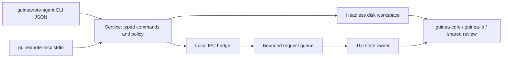

# Kế hoạch CLI và MCP cho AI Agent

Ngày đánh giá: 2026-11-09. Trạng thái mới: **đã triển khai P0–P4 trên nhánh dev,
kiểm chứng native Windows**. Xem AGENT_IMPLEMENTATION.md để biết bằng chứng,
giới hạn và phần runtime Linux/macOS chưa kiểm chứng. Phần còn lại là kế hoạch
thiết kế ban đầu. Kế hoạch này bổ sung cho việc quản lý
thẻ đang triển khai, không thay thế phần cải thiện trải nghiệm người dùng.

## Kết luận và đánh giá

Nên làm **API nghiệp vụ dùng chung → CLI JSON → cầu nối phiên TUI → MCP
chỉ đọc → chỉnh sửa có kiểm soát**. Giá trị chính là để Agent đọc đúng nội dung
đang mở, kể cả chưa lưu, đề xuất thay đổi và đưa kết quả vào review trong
GuineaNote. CLI thao tác file trên đĩa đơn thuần có giá trị thấp hơn vì Agent
thường đã có công cụ filesystem.

| Phương án | Giá trị | Chi phí/rủi ro | Đề xuất |
| --- | --- | --- | --- |
| CLI JSON chỉ đọc file trên đĩa | Dễ tích hợp, dễ kiểm thử, dùng trong script | Thấp–vừa; không thấy nội dung chưa lưu | Làm trước để chốt hợp đồng |
| CLI kết nối phiên TUI | Hiểu thẻ, lựa chọn, revision và bản nháp | Vừa–cao; cần IPC, định danh và xử lý cạnh tranh | Thành phần tạo khác biệt |
| MCP server cục bộ qua stdio | Agent khám phá và gọi công cụ có schema | Vừa sau khi có API; khác biệt phiên bản giao thức | Bọc API, không nhân đôi logic |
| Chỉnh sửa/ghi file qua Agent | Tăng giá trị thực tế, có undo/review | Cao; nguy cơ ghi đè thay đổi của người dùng | Theo sau snapshot/revision/diff |
| MCP client tích hợp trong editor | Gọi dịch vụ bên ngoài từ GuineaNote | Cao; thêm credentials, network và nhiều UI | Chưa cần cho yêu cầu hiện tại |
| MCP HTTP từ xa | Chia sẻ qua mạng | Cao; thêm auth, vận hành và bề mặt truy cập | Để giai đoạn riêng |

Đánh giá trên là suy luận từ kiến trúc hiện tại và nhu cầu dùng Agent. Chưa
có benchmark MCP, thử nghiệm tương thích client hoặc số liệu chi phí thực tế.

## Nền tảng hiện có và khoảng trống

- `guinea-core` đã có Document, revision, undo/redo, snapshot và tọa độ Unicode.
- `guinea-io` đã có UTF-8 nghiêm ngặt, BOM/newline, fingerprint và lưu có kiểm
  tra xung đột. Cần giữ nguyên các bảo vệ này khi thêm transport.
- TUI có worker và event loop sở hữu trạng thái, thẻ nguồn và review liên kết.
  Lệnh F2 hiện là chuỗi trong App; chưa phải API public có schema ổn định.
- Parser/review đang nằm trong `guinea-tui`; cần tách phần phân tích thành mô
  đun dùng chung trước khi cung cấp kết quả cấu trúc cho Agent.
- Chưa có document/session handle public, capability, IPC, phân trang dữ liệu,
  patch transaction hay hợp đồng lỗi cho máy. Không thể nối thẳng F2 ra MCP.
- ID Document chỉ có ý nghĩa trong process hiện tại; một review có thể dùng
  cùng ID nguồn. API phải tách `tab_id`, `document_id` và `app_session_id`.

## Kiến trúc đề xuất



Đề xuất thêm `guinea-service` với request/result/schema và policy, cùng các
binary tùy chọn `guineanote-agent` và `guineanote-mcp`. Cách này giữ nguyên CLI
mở file/thư mục hiện tại, tránh tên file `agent`/`mcp` bị hiểu thành subcommand,
và không bắt TUI mặc định tải runtime MCP. Nếu sau này muốn một executable,
cần đánh giá lại CLI tương thích trước khi gộp.

Hai backend phải ghi rõ nguồn dữ liệu: `disk` hoặc `live`. TUI là nơi duy nhất
sửa Document của phiên đang mở. Worker chỉ tính trên snapshot; kết quả quay
về event loop để so revision và commit. Không chia sẻ App mutable giữa các
thread hoặc giữ khóa buffer trong lúc đọc đĩa, parse, gửi IPC hay serialize.

IPC: Windows named pipe giới hạn người dùng hiện tại; Unix domain socket trong
thư mục riêng với quyền hạn chế. Kết nối bằng handle phiên rõ ràng, không tự
động chọn editor gần nhất khi có nhiều phiên. Token/capability có vòng đời,
không ghi vào log hoặc đưa vào tham số lệnh dễ thấy trong process list.

## Danh mục lệnh và công cụ

Tên dưới đây là hợp đồng dự kiến, chưa phải lệnh đã chạy được.

| CLI đề xuất | MCP tool đề xuất | Pha | Hành vi |
| --- | --- | --- | --- |
| `capabilities` | `get_capabilities` | 1 | Phiên bản schema, backend, quyền, giới hạn |
| `files list/info` | `list_files`, `get_file_info` | 1/3 | Danh sách nông/phân trang, metadata |
| `documents read/search` | `read_document`, `search_document` | 1/3 | Đọc theo range; phân trang kết quả tìm |
| `documents analyze` | `analyze_document` | 1/3 | Outline Markdown, cấu trúc JSON/XML, trang hàng CSV; không thực thi nội dung |
| `sessions list` | `list_editor_sessions` | 2/3 | Chỉ các phiên được cấp quyền truy cập |
| `tabs list/activate` | `list_tabs`, `activate_tab` | 2/3 | Đếm, trạng thái nguồn/review, chuyển thẻ theo ID |
| `documents open/new` | `open_document`, `new_document` | 4 | Thay đổi phiên; tạo buffer, chưa tự ghi đĩa |
| `patch plan` | `plan_document_patch` | 4 | Validate, tạo diff và plan handle gắn revision |
| `patch apply` | `apply_document_patch` | 4 | Một transaction undo, kiểm tra revision lần nữa |
| `documents save` | `save_document` | 4 | Lưu revision xác định với fingerprint đĩa |
| `review open` | `open_review` | 4 | Split hoặc tab review, liên kết nguồn |
| `tabs close` | `close_tab` | 4 | Đóng tab; bản nháp bẩn trả conflict, không tự discard |

MVP không có shell execution, tải URL, xóa file, sửa cấu hình quyền bằng Agent,
hay mở toàn bộ filesystem. Không thêm chức năng tự gọi model, lưu API key hoặc
dịch vụ mạng chỉ để cung cấp MCP server.

Ví dụ CLI dự kiến:

```text
guineanote-agent files list --root . --json
guineanote-agent tabs list --session APP_SESSION_ID --json
guineanote-agent documents read --session APP_SESSION_ID --document DOC_ID --start 0 --limit 65536 --json
guineanote-mcp --root . --access read-only --transport stdio
```

MCP resources dùng URI riêng, ví dụ
`guineanote://APP_SESSION_ID/documents/DOC_ID`, có revision/nguồn dữ liệu và
giới hạn kích thước. Đọc range qua tool cho tài liệu lớn; không liệt kê nội
dung đầy đủ của mọi buffer trong `resources/list`. Resources là nội dung tham
chiếu, tools là thao tác. Prompt mẫu review/refactor có thể bổ sung sau.
[Đặc tả resources](https://modelcontextprotocol.io/specification/2026-07-28/server/resources),
[đặc tả tools](https://modelcontextprotocol.io/specification/2026-07-28/server/tools).

## Hợp đồng dữ liệu và cập nhật an toàn

1. Mọi kết quả có `schema_version`, `request_id`, backend, document/session ID,
   `revision`, nguồn `disk/live`, `truncated` và cursor nếu còn dữ liệu. CLI
   stdout chỉ chứa JSON; thông tin vận hành đi stderr. Trường/mã lỗi ổn định
   bằng tiếng Anh; thông báo cho người dùng có thể Việt/Anh.
2. Đề xuất tọa độ patch là offset scalar Unicode, range nửa mở, zero-based;
   điểm đầu/cuối phải là biên grapheme đúng như core. Đọc/tìm trả tọa độ theo
   cùng quy ước. Không nhầm byte, UTF-16, cột terminal hay số dòng. Adapter
   UTF-16 nếu cần phải có trường encoding rõ ràng và kiểm thử riêng.
3. `plan` nhận revision và các edit không chồng nhau, trả diff/plan handle.
   `apply` kiểm tra lại tài liệu/revision/quyền, áp dụng toàn bộ hoặc không gì,
   tạo một undo transaction. Người dùng có thể xem diff trong TUI. Một policy
   được cấp trước có thể cho phép tự áp dụng trong phạm vi đã chọn; không hỏi
   lại từng thao tác đã được cấp quyền.
4. Apply vào buffer và save ra đĩa là hai hành vi riêng. Save yêu cầu revision
   mong đợi, kiểm tra fingerprint và giữ BOM/newline. Nếu có sửa đồng thời,
   trả `REVISION_CONFLICT`/`DISK_CONFLICT`, không tự merge hay overwrite.
5. Request ghi có idempotency key và biên commit rõ ràng. Retry sau mất kết nối
   phải tra kết quả, không áp dụng patch hai lần. Khởi động lại làm handle cũ
   hết hiệu lực; trả lỗi rõ thay vì trỏ sang tài liệu khác.
6. Hủy tác vụ trước commit không đổi buffer; hủy/timeout sau commit phải cho
   phép tra transaction đã hoàn tất. Undo theo Agent chỉ được làm nếu đúng
   transaction đầu history, không hoàn tác nhầm chỉnh sửa mới của người dùng.

Mã lỗi nghiệp vụ dự kiến: `INVALID_ARGUMENT`, `NOT_FOUND`, `OUT_OF_SCOPE`,
`READ_ONLY`, `BUSY`, `REVISION_CONFLICT`, `DISK_CONFLICT`, `LIMIT_EXCEEDED`,
`CANCELLED`, `SESSION_GONE`. Adapter map theo phiên bản MCP; không tự chiếm mã
JSON-RPC dành riêng cho giao thức. Lỗi thực thi tool và lỗi protocol phải khác
nhau trong schema và test.

## Quyền truy cập và hiệu suất

- Mặc định read-only; quyền đọc buffer chưa lưu phải tách với quyền đọc đĩa.
  Workspace allowlist, canonical parent/path kiểm tra theo từng thao tác, chặn
  `..`, symlink/junction/reparse-point escape và đường dẫn đặc biệt. Không dùng
  so sánh prefix chuỗi để chứng minh path nằm trong workspace. Các giới hạn
  TOCTOU của filesystem hiện tại vẫn phải ghi rõ, không hứa sandbox tuyệt đối.
- `.env`, private keys và tệp credentials cần policy riêng/opt-in theo đường
  dẫn; log không lưu nguyên nội dung hay secret. Nội dung file là dữ liệu,
  không được coi là chỉ thị cấp quyền hoặc lệnh cần thực thi.
- Agent đã được cấp scope có thể làm trong scope đó; thay đổi quyền, discard
  bản nháp và ghi đè xung đột không được suy ra từ yêu cầu đọc thông thường.
- Mục tiêu bắt buộc giữ UI <100 ms trên corpus 10 MiB đã thống nhất. Không
  chuyển benchmark UI thành cam kết toàn bộ request MCP phải hoàn tất <100 ms.
  Đọc lớn, parse và sync file có thời gian hoàn tất riêng.
- Giới hạn dự kiến: trang nội dung 64 KiB, tối đa 200 mục/trang, request patch
  tổng 1 MiB / 100 edit, một writer/document, hàng đợi 64 request, tối đa hai
  tác vụ phân tích nặng. Đây là điểm khởi đầu cần benchmark, không phải thông
  số đã kiểm chứng. Quá tải trả BUSY, không xếp hàng vô hạn.
- Event loop có budget xử lý lệnh nhỏ theo frame; kết quả lớn serialize ngoài
  UI. Cache đọc phải gắn revision; không trả cache cũ sau sửa và không cache
  chung nội dung private giữa các scope/phiên.

## Phiên bản MCP và lựa chọn SDK

Đối chiếu nguồn chính thức ngày 2026-11-09: bản `2026-07-28` dùng giao thức
stateless, metadata theo request và discovery thay cho handshake cũ. Thiết kế
không được mặc định rằng mọi client đều đã dùng bản này; compatibility với
`2025-11-25` cần một bộ test riêng. Phân biệt session ứng dụng của GuineaNote
với session transport MCP cũ.
[Thông báo phát hành](https://blog.modelcontextprotocol.io/posts/2026-07-28/),
[base protocol](https://modelcontextprotocol.io/specification/2026-07-28/basic/index).

Với stdio, stdout phải chỉ có message MCP; stderr dành cho log, EOF là đường
shutdown có kiểm soát. Phải kiểm tra framing, cancellation và process lifecycle.
[Đặc tả stdio](https://modelcontextprotocol.io/specification/2026-07-28/basic/transports/stdio).

Ưu tiên đánh giá SDK Rust chính thức `rmcp`; README hiện nêu hỗ trợ cả modern
và legacy. Trước khi chọn dependency: kiểm tra **bản crate phát hành cụ thể**,
MSRV, license/advisory, feature stdio, schema và lifecycle conformance. README
nhánh main chưa chứng minh binary tích hợp tương thích. Không tự viết toàn bộ
protocol chỉ để tránh dependency; cũng không thêm SDK/network vào TUI mặc định.
[SDK Rust chính thức](https://github.com/modelcontextprotocol/rust-sdk).

## Lộ trình, công sức dự kiến và tiêu chí hoàn thành

Ước lượng sơ bộ cho một kỹ sư quen codebase; chưa phải lịch cam kết. Native
Windows được ưu tiên; hoàn tất kiểm thử Linux/macOS cần môi trường tương ứng.

| Pha | Sản phẩm | Công sức | Điều kiện qua |
| --- | --- | --- | --- |
| P0 | Hợp đồng typed service, CLI JSON chỉ đọc, schema fixtures | 2–3 ngày công | Đọc/tìm/info phân trang đúng, không vào terminal mode, CLI cũ không đổi |
| P1 | Session bridge, list/activate tabs, đọc live buffers | 2–4 | Một owner; đúng ID/revision; hai phiên không lẫn dữ liệu; ACL/EOF/overload đạt |
| P2 | MCP stdio read-only dùng service | 2–3 | Tools/resources/schema/cancel; modern+legacy client matrix; stdout sạch |
| P3 | Patch plan/apply, review, save theo capability | 4–6 | Diff đúng; apply atomic; một undo; conflict/retry/cancel không mất dữ liệu |
| P4 | Hardening và tài liệu tích hợp | 2–4 | Adversarial path/secret/input tests; UI budget khi Agent chạy; native client smoke |

Tổng tham khảo **12–20 ngày công**, có thể thay đổi sau P0/P1. Điểm khó nhất
là cạnh tranh sửa với người dùng và IPC an toàn, không phải khai báo tools.
MCP client/network/remote HTTP và session restore không nằm trong ước lượng.

Kiểm thử quan trọng: Unicode/NFD/ZWJ/CRLF/BOM, invalid range, cùng basename,
review không có quyền ghi, user sửa sau plan, file đổi ngoài app, queue flood,
timeout sau commit, Agent chết giữa save, request trùng, session restart,
path escape/reparse points và nội dung giống prompt injection. Chạy local
fmt/Clippy/tests/build/cargo-deny và PTY latency trong lúc Agent đọc/parse/
patch; báo cả max UI latency và thời gian hoàn tất tác vụ. Không tạo GitHub CI.

**Khuyến nghị ưu tiên:** hoàn tất quản lý thẻ và sự ổn định hiện tại, sau đó
thực hiện P0–P2 trước. Chỉ mở P3 khi định danh/revision và conformance đạt;
các lệnh ghi sẽ tái sử dụng cùng hợp đồng và safety checks của ứng dụng.
