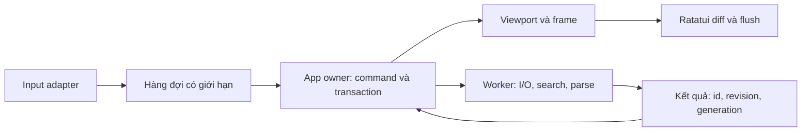

# 03 — Rendering TUI và kiểm chứng hiệu suất

Ngày: **10/11/2026**. Mục tiêu sản phẩm giữ nguyên: phản hồi thao tác **<100 ms** trên corpus và môi trường công bố. Báo cáo không biến mục tiêu này thành một lời bảo đảm cho mọi thiết bị hoặc file tùy ý.

## Hiện trạng và evidence

Đã đọc [event loop](../../crates/guinea-tui/src/lib.rs), [input adapter](../../crates/guinea-tui/src/input.rs), [workspace renderer](../../crates/guinea-tui/src/workspace_render.rs), [layout](../../crates/guinea-core/src/view.rs), [search](../../crates/guinea-tui/src/search.rs) và [review](../../crates/guinea-tui/src/review.rs).

| Cơ chế hiện có | Ý nghĩa | Điều chưa được bảo đảm |
| --- | --- | --- |
| Ratatui 0.30.2 + Crossterm 0.29.0 | Stack đang triển khai, không chỉ dự kiến | Tương thích terminal thực tế cần native tests |
| Chỉ draw khi `app.redraw` | Không phát frame liên tục khi idle | Một draw vẫn có thể đắt |
| Chờ input 250 ms idle, 8 ms khi có job | Blocking wait có thể bị input đánh thức; không phải mỗi phím luôn chờ 250 ms | Chi phí poll và job completion cần đo riêng |
| Coalesce tối đa 128 events hoặc khoảng 4 ms | Giảm frame cho burst, giới hạn starvation | Handler đơn lẻ có thể vượt budget |
| Dựng các dòng trong viewport bằng `line_window` | Không render mọi dòng trong file | Index, vị trí caret và lexical context có thể đắt |
| Windows native input channel cap 1.024 events | Tránh lỗi UTF-16/key-up đã ghi nhận | Paste/resize/focus trên terminal khác chưa đủ evidence |
| Search worker cap 2, debounce 35 ms, page 200 | Kết quả hữu hạn, coalesce truy vấn | Full scan/full-text allocation và replacement cancellation còn chi phí |
| Review chạy worker, cache theo id/revision/width/language/locale | Không parse trong key handler | Row cap 100.000 chưa đồng nghĩa cap bytes AST/RSS |

Số liệu **đã được repository ghi lại ngày 09/11**, không phải đo lại trong nghiên cứu:

| Corpus native Windows release | Quan sát |
| --- | --- |
| Tổng các transitions đã lưu | 451 |
| Mẫu dưới 100 ms | 450 |
| Failure cần giữ lại | `unicode:first-end` **916.326 ms** |
| Bốn lượt navigation lặp lại | 128 mẫu, max 14.848 ms; không xóa failure ban đầu |
| Search kiểm tra cuối | 13 mẫu, max phản hồi 67.142 ms |
| Search / page / replace-all 10 MiB hoàn tất | 118.380 / 71.676 / 151.381 ms, tách khỏi phản hồi ban đầu |

Nguồn: [manifest](../dialog-search-validation.json), [performance](../PERFORMANCE.md), [outlier gốc](../responsiveness-navigation-dialog-outlier.json), [lượt search cuối](../responsiveness-dialog-search-final-copy.json). Các mẫu gồm ConPTY và Python screen parsing; không đo thời điểm màn hình vật lý phát sáng. Không suy ra p99 tin cậy từ tổng corpus hỗn hợp này. Chưa xác định nguyên nhân outlier; các điểm nghi ngờ trong tài liệu là giả thuyết cần trace.

## Ratatui diff không loại bỏ chi phí dựng frame

Ratatui dùng immediate mode: ứng dụng dựng frame hiện tại; double buffer tính diff để chỉ gửi cells thay đổi ra terminal. Vì vậy phải phân biệt **lượng tính toán chuẩn bị frame** với **lượng bytes output**. Nguồn: [rendering](https://ratatui.rs/concepts/rendering/), [double-buffer và flush](https://ratatui.rs/concepts/rendering/under-the-hood/).

Đề xuất giữ Ratatui và lớp diff mặc định. Chưa tự viết backend escape sequences hoặc một thuật toán terminal diff khác. Tối ưu ở phía app theo thứ tự:

1. Không gọi draw nếu nội dung hiển thị không đổi.
2. Chỉ truy xuất text, style và selection cần trong viewport.
3. Cache layout/highlight theo revision và range; reuse kết quả cho frame kế.
4. Ghi metrics frame-build, diff/flush, output bytes để chọn điểm nghẽn thật.
5. Chỉ thử widget/cell cache sâu hơn nếu profiling chứng minh cần.

**Cạm bẫy:** không đơn giản bỏ vẽ các widget “không dirty” trong một frame mới. Buffer đích phải có đủ nội dung hợp lệ; nếu bỏ mà không replay/cache đúng, vùng không vẽ có thể bị xóa. Dirty regions trước hết dùng để invalidate cache và giảm tính toán; terminal vẫn nhận một frame logic đầy đủ.

## Invalidation và viewport đề xuất

| Sự kiện | Cache cần invalidation | Công việc được phép trên UI |
| --- | --- | --- |
| Di chuyển caret không sửa text | Caret/selection overlay, scroll nếu ra viewport | Cập nhật view và tra checkpoint đã có |
| Edit nhỏ | Range text, layout dòng liên quan; syntax state tới điểm ổn định | Apply transaction, đánh dấu dirty, xếp job |
| Thay theme/ngôn ngữ UI | Style/text UI cache | Dựng lại frame; không parse source vì đổi ngôn ngữ UI nếu parser không cần |
| Scroll | Visible ranges; giữ line caches hợp lệ | Tra viewport; yêu cầu dữ liệu thiếu |
| Resize | Geometry, wrap theo width, hit regions | Coalesce kích thước mới nhất và vẽ lại |
| Worker trả revision cũ | Không áp dữ liệu cũ | Drop hoặc chuyển reclaim sang worker nếu quá lớn |
| AI acquire/release | Tab/access badges và action availability | Commit quyền truy cập ở owner |

Đề xuất key layout chứa doc revision, line/range, tab width, width policy; key syntax thêm language/grammar version. Không dùng một dirty flag toàn app để xóa mọi cache văn bản. Cache có quota theo bytes; LRU hoặc một số dòng hoạt động là đủ trước khi xây hệ phức tạp.

Hiện source renderer gọi `BasicSyntax.highlight_line` với **text window đã cắt**, không phải trạng thái lexer từ đầu dòng. Điều này giới hạn màu cú pháp khi scroll ngang giữa string/comment, ngoài giới hạn lexer line-local đối với multiline syntax. Đây là thiếu ngữ cảnh thấy trực tiếp trong source, chưa phải crash hay benchmark. Giải pháp: lexer checkpoints theo dòng/range hoặc parse snapshot ở worker, rồi clip spans; khi chưa có kết quả đúng, dùng plain text tạm thay vì màu sai. Tách việc mở được mọi file UTF-8 khỏi tuyên bố “mọi ngôn ngữ đều có grammar chính xác”.

## Event loop, worker và độ trễ

Giữ owner duy nhất cho document mutable. Đề xuất luồng xử lý:

UI không clone vector history, quét full document, parse dữ liệu hay đọc disk trong handler. Việc commit snapshot có thể swap root rẻ, nhưng **drop root/history/cache cũ cũng phải nằm trong profiling**. Deferred destruction chỉ thêm nếu chứng minh nó chặn UI; phải có queue giới hạn để không tích RAM vô hạn.

Ưu tiên input và commit ngắn; resize/search requests dùng latest-wins. Giới hạn CPU workers theo toàn process, không chỉ từng tab: review nhiều tab cộng với layout parallel workers tối đa 8 có thể tranh CPU với input. Không suy ra cần Tokio toàn app: bounded channels + worker pool nhỏ có thể đủ, Tokio hiện đã phục vụ adapter Agent. Cần cancellation cooperative theo chunk; replacement hiện chủ yếu kiểm tra cancel sau preparation nên có thể tiếp tục tốn CPU dù panel đã đóng. Không bỏ safety checks để tiết kiệm vài ms.

## Unicode, keyboard, mouse và capability

**Unicode:** phân biệt bytes, scalars, graphemes, cells và UTF-16. UAX #29 định nghĩa segmentation; UAX #11 không phải thuật toán hoàn chỉnh để đo mọi terminal emoji. Cần fixture ZWJ, CJK, combining marks, ambiguous width và clipping giữa ký tự rộng; policy width có override. Không normalization source ngầm. Nguồn: [UAX #29 revision 49](https://www.unicode.org/reports/tr29/tr29-49.html), [UAX #11 revision 46](https://www.unicode.org/reports/tr11/tr11-46.html).

**Keyboard:** normalize adapter thành action/text event; bracketed paste là một transaction. Không coi release là ký tự mới; giữ surrogate-pair và AltGr tests native Windows. Ctrl+H/Backspace hoặc Ctrl+I/Tab có thể không phân biệt được trong giao thức cũ; F2/menu và keymap fallback phải luôn dùng được. Kitty protocol có cơ chế query/progressive enhancement, chỉ bật sau detect và khôi phục khi thoát. Nguồn: [Crossterm event 0.29](https://docs.rs/crossterm/0.29.0/crossterm/event/), [Kitty keyboard protocol](https://sw.kovidgoyal.net/kitty/keyboard-protocol/).

**Mouse:** mouse là bổ sung, không bắt buộc. Hit regions cần theo đúng geometry frame mới; modal chặn click xuyên; resize phải invalidate hit test cũ. Drag chọn theo grapheme, wheel cuộn view không thay caret; cả keyboard và mouse đi qua cùng command và quyền readonly/AI lease. Dùng local PTY tests hiện có làm regression suite, sau đó chạy native Linux/macOS và SSH/tmux.

**Màu và terminal:** giữ navy tối, xanh lá, hổ phách `#DBAD5B`, trắng ấm và nâu ở chi tiết. True Color → 256 → 16/mono là capability policy đề xuất; không thay nền sang xanh. Hiện `basic_colors` chỉ có RGB/256, mặc định dựa Windows/COLORTERM. Đã tìm trong source app và không thấy xử lý `NO_COLOR`, trong khi README nói có; cần sửa lệch hợp đồng ở milestone tới, không coi đó là tính năng đã xác minh. `NO_COLOR` không tương đương chọn palette 256. Nguồn: [config](../../crates/guinea-tui/src/config.rs), [theme](../../crates/guinea-tui/src/theme.rs), [quy ước NO_COLOR](https://no-color.org/).

Capability detection không chỉ dựa biến môi trường. Có explicit override, timeout query, không làm probe chặn first paint; nhận biết non-TTY/TERM=dumb và trả lỗi hữu ích. RAII guard hiện có cần tiếp tục kiểm tra restore raw mode, cursor, alternate screen, mouse, paste và protocol state sau lỗi/panic; process kill không thể trông chờ Drop.

## Clipboard qua SSH

Đề xuất provider `Internal / Local OS / Terminal OSC 52`. Internal luôn hoạt động. OSC 52 cần user policy và giới hạn payload, không query clipboard tự động khi mở file, tránh log nội dung. Copy gửi qua terminal có thể dùng từ xa; khả năng nhận phụ thuộc emulator, SSH và tmux. Paste ưu tiên bracketed paste do terminal gửi; không hứa terminal nào cũng cho đọc clipboard. Crossterm 0.29 có module copy clipboard, không có nghĩa GuineaNote đã bật/tích hợp. Nguồn: [Crossterm clipboard](https://docs.rs/crossterm/0.29.0/crossterm/clipboard/), [tmux set-clipboard](https://man.archlinux.org/man/tmux.1.en).

Không thêm command shell lấy từ file/project để xử lý clipboard. Nếu provider local cần tiến trình helper, nói rõ phụ thuộc tùy chọn; binary editor và internal clipboard vẫn chạy độc lập.

## Rust native so với TypeScript/Node.js

**Sự thật có nguồn:** Rust quản lý memory theo ownership, không cần tracing GC cho heap thông thường. Node/V8 có GC, heap và external memory; Node yêu cầu không block event loop bằng CPU work. Nguồn: [Rust ownership](https://doc.rust-lang.org/book/ch04-01-what-is-ownership.html), [Node memory](https://nodejs.org/learn/diagnostics/memory/understanding-and-tuning-memory), [Node event loop](https://nodejs.org/learn/asynchronous-work/dont-block-the-event-loop).

**Suy luận cần đo:** Rust có thuận lợi cho startup độc lập runtime, layout memory, worker native và controlling allocations. Nhưng allocation, refcount, copy, destructors, lock, page faults, filesystem và terminal transport vẫn gây latency. TypeScript/Node có JIT, streams và worker threads; cấu trúc dữ liệu tốt có thể quan trọng hơn ngôn ngữ. VS Code từng không đạt cải thiện mong muốn chỉ bằng chuyển buffer qua native boundary; đây là kinh nghiệm của họ, không là benchmark GuineaNote. Không đưa hệ số nhanh hơn hay số RSS so sánh chưa đo.

Giữ Rust vì yêu cầu native runtime, kiến trúc đã có và mục tiêu phân phối; chưa có căn cứ chuyển TypeScript. Không dùng GUI Electron làm đối thủ duy nhất cho một Rust TUI, cũng không quy toàn RSS của GUI cho Node.

## Thiết kế benchmark công bằng

### Hai lớp thí nghiệm

1. **Engine:** cùng semantic operations và data structure tương đương, kiểm tra output exact bytes; không terminal. Đo Rust Ropey và implementation TypeScript được công bố/versioned nếu muốn tách ảnh hưởng runtime. Nếu cấu trúc khác nhau, gọi là so sánh implementation, không là so sánh riêng ngôn ngữ.
2. **Ứng dụng:** cùng máy/OS/terminal/viewport/features; cùng corpus và script thao tác. Cố định theme/syntax/wrap/plugins và loại bỏ LSP ngoài khi không ở workload đó. Công bố đối thủ, commit, runtime version, compiler flags và config.

`npx` first-download không so với direct binary warm startup. Đo riêng download/install, launcher startup và direct runtime. Không dùng giới hạn string V8 trong bài viết 2018 làm giới hạn Node 2026.

### Metrics và mốc thời gian

| Metric bắt buộc | Định nghĩa có thể tái lập |
| --- | --- |
| Startup latency | Spawn → first usable frame; riêng empty và mở file; tách launcher/TTY startup |
| Peak RSS | Peak trong open/edit/search/save/recovery; đo cả cây process, Windows working set/private bytes riêng, không trộn đơn vị |
| File open | Request → nội dung đúng sẵn sàng điều hướng; có thể báo first viewport và full-index ready riêng |
| Insert/delete | Event → transaction và frame chứa thay đổi; typing, paste, selection lớn, random edit |
| Search | Query → feedback; query → kết quả đầu; query → count/full scan hoàn tất, hiện diện/vắng/hàng triệu matches |
| Save | Request → feedback; request → temp write/sync/replace và báo outcome; hash file sau cùng để xác minh |
| Terminal render | Frame build; diff/flush; số bytes output; PTY-observed frame; physical paint nếu có thiết bị đo |
| p95/p99 input | Phân bố theo loại thao tác, cả cold lần đầu; thêm max và số mẫu >=100 ms |
| CPU idle | 60 giây sau ổn định, CPU seconds, wakeups, bytes output; không chỉ một snapshot CPU% |

Mốc đề xuất `T0` input injection, `T1` adapter nhận, `T2` command commit, `T3` flush, `T4` observer đọc frame đúng. Công bố metric nào dùng; flush xong không đồng nghĩa người dùng đã nhìn thấy. Với SSH, RTT có thể tự vượt 100 ms; tách latency local app và end-to-end remote, không đổ lỗi cho terminal khi chưa đo.

### Corpus và quy trình

- Kích thước chính xác: 1.000.000; 10.000.000; 100.000.000; 500.000.000; 1.000.000.000 bytes; giữ thêm fixture 10 MiB để đối chiếu lịch sử.
- Nhiều dòng rất ngắn, dòng thông thường, một dòng dài, Unicode và tabs; source code, JSON minified, CSV rộng, Markdown dài, mixed endings, invalid UTF-8 bị từ chối.
- Typing đều và burst; key repeats; End cold; drag xa; resize liên tục; replace-all output lớn; 50 tabs; history tăng dần; Agent/review đồng thời; external writer và save errors.
- Ghi corpus generator seed/SHA-256, phần cứng, power plan, nhiệt độ/throttle khi có, storage/filesystem, toolchain, binary hash và background load. Không đo trong lúc build/audit.
- Tách cold/warm filesystem cache. Nếu không kiểm soát được cold cache, ghi “fresh process, cache không kiểm soát”, không gọi cold disk.
- Đề xuất ít nhất 30 process-start trials và 10.000 input samples cho mỗi nhóm latency chính, nhiều session độc lập; randomize thứ tự A/B và công bố raw samples. Đây là protocol tương lai, không số đã đo.
- Không dùng vòng “gửi một phím, chờ xong rồi mới gửi” làm thí nghiệm duy nhất: thêm fixed-rate/replay theo timestamp để không che queue buildup/coordinated omission.
- Report p50/p95/p99 theo phương pháp percentile đã ghi, max, failure count và uncertainty. Không gộp hành động khác nhau để che đuôi latency.

### Cổng chấp nhận

Trong workload interactive đã công bố, **mỗi mẫu >=100 ms là một failure**, kể cả khi p99 đẹp. Các mục tiêu nội bộ đề xuất: handler/commit p99 <=8 ms, dựng frame p99 <=12 ms để có headroom; đây là budget kỹ thuật chưa đạt kiểm chứng. Đo full completion riêng và không gọi việc hiện “Đang xử lý” là hoàn tất save/search. Nếu toàn thao tác không thể hoàn tất <100 ms do khối lượng dữ liệu, phải nêu giới hạn thay vì đổi nghĩa yêu cầu.

Ưu tiên trước hết là trace cold End 916 ms, với spans input/queue/layout/clone/drop/frame/flush và OS scheduling. Không xóa outlier, không chỉ rerun đến khi pass, không khẳng định một tối ưu sửa nó khi chưa có reproduction hoặc trace. Không benchmark mới trong đợt tài liệu này.
