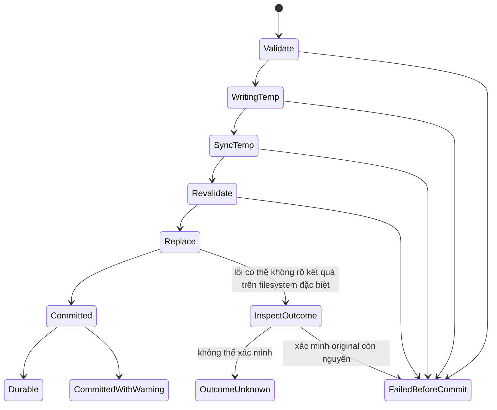

# 04 — Bảo toàn file, Unicode và phục hồi

Ngày: **10/11/2026**. Nguyên tắc: không decode lossy rồi ghi đè, không tự normalize, không báo save thất bại chung chung sau khi file thực tế đã được thay. Không có thuật toán user-space nào bảo đảm tuyệt đối trước mọi lỗi phần cứng, filesystem hoặc hostile writer; hợp đồng và giới hạn phải cụ thể.

## Các bảo vệ hiện có đã đọc trong source

Nguồn chính: [guinea-io](../../crates/guinea-io/src/lib.rs), [Document](../../crates/guinea-core/src/document.rs), [FILE_SAFETY](../FILE_SAFETY.md). Evidence kiểm thử được kế thừa từ repository, không chạy lại trong nghiên cứu.

| Tình huống | Hành vi hiện tại | Đánh giá |
| --- | --- | --- |
| UTF-8/BOM | Strict UTF-8, BOM lưu riêng; từ chối UTF-16 BOM, invalid UTF-8 và NUL | Nên giữ cho MVP |
| Newline | Bytes LF/CRLF/mixed nằm nguyên trong Rope; policy chèn mới là CRLF nếu thuần CRLF, còn lại LF | Bảo toàn không sửa; cần mô tả rõ policy mixed |
| Open | Metadata trước/sau, limit+1 chống tăng file; warning mặc định 10 MiB | Warning không phải quota RAM; xác nhận bỏ limit có thể mở rất lớn |
| Path | Canonicalize parent; từ chối final symlink và non-regular file | Bảo thủ, chưa là phòng vệ mọi race/reparse point |
| Conflict | So fingerprint length/mtime/SHA-256 trước save và kiểm tra lại trước replace | Tốt hơn chỉ mtime; vẫn còn TOCTOU |
| Save | Temp cùng thư mục, write/flush/sync; copy Rust permissions; persist/persist_noclobber | Giữ cơ chế không delete original làm fallback |
| Dirty/history | Chỉ cập nhật savepoint sau commit; background save giữ edit mới hơn dirty | Nên giữ và mở rộng test |
| Post-commit sync | Unix cố sync directory; lỗi là warning sau commit | Phải giữ outcome phân biệt |
| Crash recovery | Chưa có | Temp save không phục hồi draft chưa lưu |

Test đã lưu gồm lỗi write/flush/sync/replace, native Windows sharing/permission failure và kill child ở năm barrier trước commit. Chưa thử mất điện, disk full thật, syscall replacement bị ngắt, runtime Linux/macOS, network filesystem và đầy đủ metadata. Windows symlink test trước đây bị thiếu privilege; cross-compile test Unix không thay native execution.

## Unicode là năm loại tọa độ

| Tọa độ | Công dụng | Bất biến cần giữ |
| --- | --- | --- |
| Byte offset | UTF-8 file, chunk, hash, I/O | Không slice giữa code point khi tạo text |
| Unicode scalar index | Ropey edit/query | Không đồng nhất với ký tự người dùng nhìn thấy |
| Grapheme boundary | Caret, Backspace/Delete, selection | Không tách NFD, ZWJ, variation sequence |
| Terminal cell | Căn cột, tabs, mouse hit test, clip | Không lấy `chars().count()` làm width |
| UTF-16 code units | LSP sau MVP | Kiểm tra surrogate boundary và protocol encoding |

Chuẩn tham khảo: [UAX #29 revision 49](https://www.unicode.org/reports/tr29/tr29-49.html), [UAX #11 revision 46](https://www.unicode.org/reports/tr11/tr11-46.html). Dependency hiện tại có Unicode data version riêng; đọc chuẩn mới không chứng minh thư viện đang dùng đã hỗ trợ mọi ký tự của chuẩn đó. Cần ghi version khi nâng dependency trong giai đoạn triển khai sau.

Đề xuất giữ source bytes NFC/NFD nguyên trạng; không tự sửa bằng canonical normalization. Search hiện là literal/case-sensitive và giới hạn match theo grapheme boundary; cần mô tả rằng tìm một combining mark nằm trong cluster có thể không chọn thành match độc lập. Case folding/normalization search là tùy chọn sau, phải map kết quả về offsets gốc đúng.

Control characters/escape sequences trong source phải hiển thị dạng an toàn; không gửi nội dung file trực tiếp thành lệnh terminal. Preview HTML/XML/Markdown và notebook không thực thi script, external entity, command, output hay mở link tự động. Filename không phải UTF-8 phải được giữ bằng `Path/OsString`; tên đã display lossy không dùng làm identity để save.

## Encoding và newline

MVP nên chỉ cho sửa UTF-8 có/không BOM. Với encoding khác, báo rõ unsupported hoặc mở viewer read-only có policy riêng; không tự đoán rồi save. Bytes hợp lệ UTF-8 nhưng vốn thuộc encoding legacy không thể luôn nhận diện bằng heuristic. Từ chối NUL cũng không phải detector nhị phân hoàn chỉnh.

Sau MVP có thể thêm UTF-16LE/BE và chọn encoding thủ công, nhưng cần lưu original encoding, BOM, decoder error policy và khả năng encode lại. Nếu ký tự mới không biểu diễn được trong encoding đích, fail trước replacement và cho Save As UTF-8. Không dùng API mặc định thay ký tự hoặc HTML numeric references một cách âm thầm; thư viện encoding hướng web có chính sách khác editor. Nguồn: [encoding_rs](https://docs.rs/encoding_rs/latest/encoding_rs/), trang đã đọc hiển thị 0.8.44.

Ropey hiện tắt `unicode_lines` và `cr_lines`, bật lại SIMD; line model dựa LF/CRLF. Bare CR giữ nguyên bytes nhưng không tự thành một logical line như cấu hình mặc định thư viện. `LineEnding::Mixed` hiện cũng dùng cho bare CR; nên cải thiện nhãn/thống kê sau khi có tests, không thay bytes để “sửa” nhãn. Nguồn: [Cargo core](../../crates/guinea-core/Cargo.toml), [Ropey line breaks](https://docs.rs/ropey/1.6.1/ropey/).

Acceptance bắt buộc: open/save không sửa phải byte-for-byte cho BOM, không có final newline, LF, CRLF, mixed, bare CR, Unicode line separators và NFD. Sửa một vùng chỉ thay bytes của vùng và newline chủ ý chèn; formatter là command riêng có preview/Undo.

## Streaming I/O đề xuất

Hiện open đọc vào `Vec<u8>` rồi tạo Rope; save tạo `String` rồi `Vec<u8>` BOM. Mục tiêu cải tiến là giảm peak RSS và copy, không bỏ kiểm tra dữ liệu:

1. Open bằng handle, đọc chunks và validate UTF-8 incremental; giữ tối đa phần code point còn dở giữa chunks. Nhận diện BOM kể cả chunk đầu ngắn, hash trên **bytes gốc**, không trên text bỏ BOM.
2. Dùng builder cho Rope trong worker; kiểm tra limit cả metadata và số bytes thực đọc. Không công bố document editable trước khi validation/safety checks hoàn tất.
3. So file identity và metadata qua handle trước/sau; xác minh path vẫn trỏ tới đối tượng mong đợi khi cần. Cần nêu đây vẫn không phải snapshot tuyệt đối trước writer tùy ý.
4. Save immutable snapshot bằng chunk iterator vào temp `BufWriter`; cập nhật hash/BOM và thống kê theo cùng stream. `flush` BufWriter trước `sync_all`; fingerprint của file đã commit phải khớp bytes vừa ghi.
5. Cancellation trước commit giữ original và dirty/history. Một lần rename đã thành công không được “cancel” bằng xóa/khôi phục tùy tiện.

Ropey có API builder/chunks hỗ trợ hướng này; đó là API khả dụng, chưa phải implementation GuineaNote. Nguồn: [RopeBuilder](https://docs.rs/ropey/1.6.1/ropey/struct.RopeBuilder.html), [chunks/read/write](https://docs.rs/ropey/1.6.1/ropey/struct.Rope.html).

## Safe save: state machine thay cho một bool

`FailedBeforeCommit`, `Committed`, `CommittedWithWarning`, `OutcomeUnknown` là **đề xuất kiểu outcome**, không tuyên bố enum hiện đã tồn tại. Khi outcome unknown, giữ draft và bản recovery/temp có thể xác định an toàn, không tự retry overwrite. Không được khẳng định mọi rename error nghĩa là chưa commit trên NFS.

### Linux

Rename cùng filesystem có atomic name replacement theo hợp đồng Linux, nhưng open handles/hard links cũ còn tồn tại. `fsync(file)` không tự bảo đảm directory entry đã durable; phải xét `fsync(parent)`. Remote filesystem có semantics/failure riêng. Nguồn: [rename(2)](https://man7.org/linux/man-pages/man2/rename.2.html), [fsync(2)](https://man7.org/linux/man-pages/man2/fsync.2.html).

### Windows

Không gán `NamedTempFile::persist` tương đương mọi đặc tính của `ReplaceFileW`. API ReplaceFileW có hợp đồng metadata, access/share flags và error cases riêng; không phải lời hứa của wrapper đang dùng. Antivirus, file handle không cho share-delete, readonly và reparse point phải có test. Nếu sau này đổi primitive để giữ ACL/ADS tốt hơn, cần thiết kế và native tests trước, không thêm fallback delete-then-rename. Nguồn: [ReplaceFileW](https://learn.microsoft.com/en-us/windows/win32/api/winbase/nf-winbase-replacefilew), [tempfile persist](https://docs.rs/tempfile/3.27.0/tempfile/struct.NamedTempFile.html#method.persist).

### macOS

Giữ temp cùng volume và xem xét đồng bộ parent; durability của drive không đồng nhất với atomicity của namespace. Tài liệu Apple lưu trữ phân biệt fsync và F_FULLFSYNC; đây là nguồn lịch sử, chưa xác minh hành vi APFS/toolchain đang nhắm. Cần test/đọc API native hiện hành trước khi cam kết chế độ durable mạnh. Nguồn: [Apple fsync manual](https://developer.apple.com/library/archive/documentation/System/Conceptual/ManPages_iPhoneOS/man2/fsync.2.html).

## External modification, symlink và metadata

Fingerprint SHA-256 hiện tại đáng giữ. Đề xuất bổ sung file identity (Unix device/inode; Windows file identity qua safe wrapper) và dùng handle ổn định cho kiểm tra. Mtime/size bằng nhau không chứng minh cùng file; SHA trên nội dung cũng không chứng minh path không bị đổi sau kiểm tra. Watcher chỉ là thông báo sớm, không thay revalidation trước save.

Giữ chính sách refuse final symlink của MVP; UI chỉ hướng dẫn mở real path. Không âm thầm replace symlink bằng regular file hoặc follow link mới khi target đổi. Nếu hỗ trợ symlink về sau, hợp đồng phải nói rõ sửa target nào, cách pin identity và đường dẫn hiển thị. Parent canonicalization hiện không loại mọi parent-path race; junction/reparse và network share cần review riêng.

Rust `Permissions` không bao trọn ownership, ACL, xattrs, SELinux labels, Windows ADS hoặc mọi timestamp. Atomic replacement còn có thể tách hard-link identity: các link khác tiếp tục giữ nội dung cũ. Đề xuất cảnh báo/chặn khi phát hiện loại metadata không bảo toàn được, hoặc cho Save As có giải thích; không quảng cáo “preserve metadata” chỉ dựa copy mode bits. Metadata probe thất bại phải có trạng thái rõ, không mặc định là không có metadata đặc biệt.

## Crash recovery, swap, autosave và backup

| Cơ chế | Bảo vệ gì | Không thay thế gì |
| --- | --- | --- |
| Atomic/safe save | Giảm nguy cơ partial overwrite khi lưu | Draft chưa từng lưu |
| Recovery snapshot/journal | Edit chưa commit disk khi crash | Backup lịch sử và conflict resolution |
| Swap file | Có thể làm backing store/recovery/lock tùy thiết kế | Không tự bảo đảm nhất quán |
| Autosave recovery | Ghi draft vào kho riêng | Không được âm thầm ghi đè source |
| Backup version | Khôi phục phiên bản đã lưu trước | Không cứu mọi edit kể từ checkpoint |

**Đề xuất post-MVP ưu tiên cao:** recovery snapshot đầy đủ cho phạm vi <=10 MiB trước một delta journal phức tạp. Write ở worker, quota tổng và retention; file private theo user, không để token/.env lọt vào log hoặc thư mục chia sẻ. Snapshot có schema version, document identity, original fingerprint, BOM/newline policy, revision, length và checksum. Durable checkpoint dùng temp/sync/replace của chính recovery store. Không xóa checkpoint cũ trước khi checkpoint mới được xác nhận.

Sau restart, mở recovery thành draft và đưa diff với disk; nếu base fingerprint khác thì không auto-replay overwrite. Chỉ compact/xóa recovery sau save thành công hoặc người dùng discard có chủ ý. Nếu tiến tới delta journal cần sequence number, checksum từng record, checkpoint/truncation rules và idempotent replay; phải xử lý record cuối ghi dở. Source bị thay bên ngoài làm base mismatch phải giữ cả hai phiên bản.

Backup là opt-in trước commit, tên/version/retention rõ, ưu tiên cùng quyền bảo vệ với source. Nếu yêu cầu backup mà tạo backup lỗi, phải dừng trước overwrite. Không hardlink làm “backup immutable” nếu writer khác còn có thể sửa inode đó. Không coi autosave recovery là quyền tự lưu file gốc.

## Acceptance và fault matrix

| Nhóm test cần có | Oracle |
| --- | --- |
| UTF-8 chunk boundaries, BOM, NFD/emoji/CRLF | Bytes roundtrip và caret không cắt grapheme |
| Error create/write/short-write/flush/sync/replace | Original hash đúng; draft/history/savepoint còn nguyên trước commit |
| Kill trước commit | Original nguyên, recovery/temp policy rõ |
| Kill sau commit trước directory sync | Phân biệt file đã commit với durability chưa xác nhận |
| Disk full/quota thật, readonly, sharing violation | Lỗi có hành động; không delete original |
| Writer đồng thời/same mtime/rename target | Conflict hoặc outcome rõ; không quảng cáo CAS khi không có |
| Symlink/hardlink/junction, non-UTF-8 filename | Không ghi nhầm đối tượng; policy được kiểm tra native |
| POSIX mode/ACL/xattrs/ADS/ownership | Bảo toàn thứ đã hứa; cảnh báo thứ không hỗ trợ |
| Recovery stale/corrupt/record truncated/base mismatch | Không mất source, không replay sai, giữ bản có thể cứu |
| UTF-16/legacy encode không biểu diễn được | Từ chối trước replace; không lossy silently |

Test suite phải chạy native Windows/Linux/macOS với filesystem ghi rõ; cross-Clippy không đủ. Power loss thật là nghiên cứu riêng, không mô phỏng bằng việc trả lỗi rồi gọi là đã kiểm chứng. Chỉ đưa guarantee đã có oracle và evidence; chi tiết priority nằm ở [roadmap](05_FEATURE_PRIORITY_ROADMAP.md).
