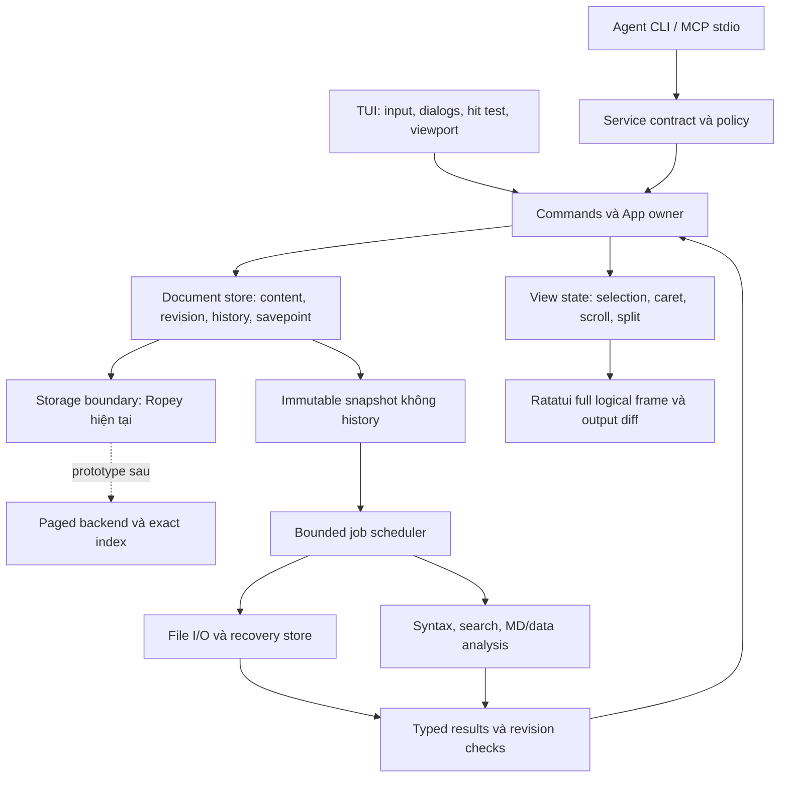

# 07 — Đề xuất kiến trúc GuineaNote

Ngày: **10/11/2026**. Baseline: `dev`, commit **`3186ddf49e181d14f465f29af1e8a6e7e4392383`**, workspace version 0.1.0. Nghiên cứu chỉ tạo tài liệu trong `docs/research/`; không sửa ứng dụng, cài dependency, tạo CI, commit, push hoặc publish.

## Quyết định tổng thể

**Giữ Rust native, Ratatui/Crossterm, Ropey và ownership một luồng cho state. Nâng cấp theo từng bước có evidence; chưa đổi text engine hay viết lại kiến trúc.** Ưu tiên hardening latency và memory, contract file safety, rồi UX còn thiếu; backend file lớn/LSP/plugin theo milestone sau.

Chi tiết chuyên đề: [editor](01_EDITOR_COMPARATIVE_RESEARCH.md), [text engine](02_TEXT_ENGINE_ARCHITECTURE.md), [render và Rust/TypeScript benchmark](03_TUI_RENDERING_PERFORMANCE.md), [file safety](04_FILE_SAFETY_AND_UNICODE.md), [feature roadmap](05_FEATURE_PRIORITY_ROADMAP.md), [distribution](06_CROSS_PLATFORM_DISTRIBUTION.md), [nguồn](08_RESEARCH_SOURCES.md).

## Những gì repository thực sự có

| Thành phần | Trách nhiệm hiện tại đã đọc | Đánh giá |
| --- | --- | --- |
| Root CLI | Clap, files/folder, config, VI/EN, readonly, Agent flags | Gọn; tên `guineanote` chưa khớp CLI mới `guinote` |
| `guinea-core` | Buffer/Ropey, document, history, grapheme, tọa độ, sparse display layout | Boundary text tốt; Document vẫn chứa view selection/cache và concrete storage |
| `guinea-io` | Strict UTF-8/BOM, fingerprint, path policy, temp save | Bảo thủ, có failure tests; còn copy và platform metadata limitations |
| `guinea-tui` | App owner, commands, tabs, explorer, modal/mouse, render, preview/search workers, preferences | Nhiều chức năng đã dùng được; orchestration/parser/view logic tập trung |
| `guinea-syntax` | Language detection và basic line-local highlight | Tách revision spans là đúng; chưa full grammar/multiline context |
| `guinea-service` | Typed Agent commands, live channel, IPC/policy, bounded analysis | Không phụ thuộc Ratatui; kết quả và access control có revision/lease |
| `guinea-agent` | JSON CLI và rmcp stdio binaries | Adapter tách process; không cần plugin runtime trong editor |

Nguồn code: [manifest](../../Cargo.toml), [core](../../crates/guinea-core/src/document.rs), [I/O](../../crates/guinea-io/src/lib.rs), [App](../../crates/guinea-tui/src/app.rs), [live contract](../../crates/guinea-service/src/live.rs), [syntax](../../crates/guinea-syntax/src/lib.rs). Dependency graph có TUI → service và service → core/I/O/syntax; không thấy vòng TUI ↔ service từ manifest. Không đề xuất phá boundary này chỉ để đổi tên crate.

Tài liệu lịch sử có đoạn lỗi thời: dirty hiện so state token/BOM `O(1)`, không còn so toàn văn bản mỗi lần; save cho phép tiếp tục edit; poll khi background là 8 ms, không phải luôn 250 ms; renderer dùng line window; Agent đã tồn tại. Báo cáo lấy source hiện tại làm chuẩn khi có xung đột. Xác nhận qua [document](../../crates/guinea-core/src/document.rs), [loop](../../crates/guinea-tui/src/lib.rs), [workspace renderer](../../crates/guinea-tui/src/workspace_render.rs).

Dirty state token là quyết định hợp lý: Undo đúng savepoint clean, nhưng tự gõ lại cùng bytes qua một history branch khác có thể vẫn dirty. Đây là bảo thủ, không phải false-clean hoặc mất dữ liệu. Không quay về full-content compare trên mỗi phím chỉ để đồng nhất hai khái niệm.

## Top 10 bài học kỹ thuật đáng áp dụng

| # | Bài học | Áp dụng cụ thể | Nguồn / ưu tiên |
| --- | --- | --- | --- |
| 1 | Đo đường đi toàn thao tác, gồm lần đầu | Trace decode/queue/layout/commit/drop/frame/flush; giữ outlier | [evidence local](../PERFORMANCE.md), [protocol](03_TUI_RENDERING_PERFORMANCE.md) / P0 |
| 2 | Immutable snapshot không đồng nghĩa clone cả document | Worker nhận content/metadata tối thiểu, không nhận vector Undo/Redo | [Document source](../../crates/guinea-core/src/document.rs), [Helix core](https://github.com/helix-editor/helix/blob/ba40e547426b0f9896c8bdc699a4ab11f2b37dbc/helix-core/src/lib.rs) / P1 |
| 3 | Document và view là hai identity | Một nội dung/history; caret/selection/scroll riêng mỗi view | [Kate](https://github.com/KDE/kate/blob/d6977a183c3badc8c4ed8ef45c29a6db4770d006/apps/lib/katemainwindow.cpp), [gedit view](https://gedit-text-editor.org/developer-docs/gedit/GeditView.html) / P1–P2 |
| 4 | Một transaction cho mọi nguồn edit | Human/Agent/search dùng expected revision, readonly/lease checks và một Undo | [core hiện tại](../../crates/guinea-core/src/document.rs), [Helix transaction](https://github.com/helix-editor/helix/blob/ba40e547426b0f9896c8bdc699a4ab11f2b37dbc/helix-core/src/transaction.rs) / P0 |
| 5 | Giảm công trước khi terminal diff | Viewport + bounded cache + context syntax đúng; không tự bỏ widget chưa dirty | [Ratatui](https://ratatui.rs/concepts/rendering/under-the-hood/) / P1 |
| 6 | Exactness phải là capability công khai | Backend lớn trả pending nếu chưa biết line/offset, không giả số đúng | [Fresh buffer](https://github.com/sinelaw/fresh/blob/a1ce79df50b0642bdb6badd9dc9eb010c1e133cf/crates/fresh-editor-core/src/model/buffer/mod.rs), [engine đề xuất](02_TEXT_ENGINE_ARCHITECTURE.md) / P2 |
| 7 | Safe save có commit boundary | Outcome trước/sau commit rõ, streaming bytes và conflict check | [I/O local](../../crates/guinea-io/src/lib.rs), [Linux fsync](https://man7.org/linux/man-pages/man2/fsync.2.html) / P0 |
| 8 | Recovery là một subsystem riêng | Draft checkpoint/replay/version/quota, không trông chờ temp atomic save | [Neovim memline](https://github.com/neovim/neovim/blob/d175a05e0d24b2796f9624f8b6965d690394116e/src/nvim/memline.c), [recovery plan](04_FILE_SAFETY_AND_UNICODE.md) / P1–P2 |
| 9 | Tính năng phải có đường fallback và trạng thái lỗi | Help/context palette, clipboard provider, keyboard thay mouse, capability override | [Nano](https://www.nano-editor.org/dist/v9/nano.html), [Micro clipboard](https://github.com/micro-editor/micro/blob/ab37da303ae719a469236697239a00e3e1ca8b16/internal/clipboard/terminal.go) / P1 |
| 10 | Release là artifact được kiểm chứng, không chỉ build pass | Tên `guinote`, target native tests, signed manifest, package version/hash thống nhất | [distribution plan](06_CROSS_PLATFORM_DISTRIBUTION.md), [Cargo publishing](https://doc.rust-lang.org/cargo/reference/publishing.html) / P1 trước release |

## Top 5 rủi ro kiến trúc cần xử lý sớm

| # | Bằng chứng / mức chắc chắn | Tác động | Giải pháp và cổng kiểm chứng | Ưu tiên |
| --- | --- | --- | --- | --- |
| 1 | **Đã đo:** một cold End 916.326 ms; nguyên nhân chưa rõ | Vi phạm yêu cầu <100 ms, UI có thể khựng ở đường cold | Repro/trace với spans và OS scheduling, giữ samples; không chỉ lặp lại pass | P0 |
| 2 | **Đã thấy source:** history không quota, clone Document trên UI; full-text copies và nhiều worker/cache | Peak RSS/allocator/drop gây tail latency; nguy cơ OOM mất draft | Snapshot gọn, stream I/O, memory/worker quotas; đo history dài và replace-all; không giảm correctness | P1, blocker cho quảng cáo file lớn |
| 3 | **Giới hạn xác nhận:** fingerprint không phải filesystem CAS, metadata preserve chưa đầy đủ | External writer hoặc metadata đặc biệt có thể không được bảo toàn như người dùng kỳ vọng | Pin identity/handle khi phù hợp, revalidate và outcome rõ; platform tests ACL/ADS/xattrs/hardlink/reparse | P0 cho hợp đồng dữ liệu; P1 cải tiến |
| 4 | **Đã xác nhận:** chưa có crash recovery/autosave draft | Process/OS crash làm mất edit chưa lưu, dù original còn nguyên | Recovery store riêng, version/checksum/quota/base conflict; kill/restart tests | P1 thiết kế; triển khai đầu post-MVP |
| 5 | **Đã thấy source:** storage snapshot concrete, selection/cache trong Document, parser/review nằm trong TUI | Editable split/backend mới có thể kéo UI/Agent/history đổi cùng; sai context syntax khi clip | Boundary snapshot/range/delta, Document–View theo bước; parser neutral output; semantic shared tests | P1–P2 |

Không gọi các race nêu trên là exploit đã tái hiện hoặc khẳng định đã mất dữ liệu. Chúng là giới hạn thiết kế có thể ảnh hưởng bảo toàn. Native Linux/macOS/ARM chưa được chứng nhận là **rủi ro phát hành bổ sung**, không bị che bởi số unit tests Windows.

## Các quyết định nên giữ nguyên

- Rust stable/native, MIT cho code tự viết, không Node runtime của editor, không runtime plugin bắt buộc.
- Ropey MVP, Rope private, loại tọa độ tách biệt và grapheme-safe editing.
- Main owner commit state, worker chuẩn bị kết quả bất biến; id/revision/generation checks.
- Dirty theo savepoint/state token, save không xóa lịch sử; safe save không delete original để fallback.
- Strict UTF-8/BOM và byte-preserving newline; từ chối lossy/binary unsupported có thông báo.
- Ratatui/Crossterm và input adapter Windows đã có tests; tối ưu theo profiling trước khi thay framework.
- Non-modal UX, F2 fallback, VI/EN, nền navy tối và chi tiết xanh/hổ phách/trắng/nâu theo yêu cầu đã thống nhất.
- Lazy explorer, review readonly, Agent opt-in với AI badge/lease khóa đúng source và linked views.
- Phát triển kiểm tra local, chưa tạo CI; Actions chỉ nằm trong release roadmap lần này.

## Các quyết định cần xem xét lại

| Hiện tại | Vấn đề / trade-off | Lựa chọn đề xuất | Khi nào |
| --- | --- | --- | --- |
| Clone `Document` cho save/legacy compute | Dễ dùng nhưng copy history metadata trên UI | `ContentSnapshot`/`SaveSnapshot` không history; owner giữ history | R2 |
| API `text/line/slice -> String` thuận tiện | Copy lớn không cần thiết | Range/chunk cho render/search/I/O; giữ owned API cho use case nhỏ | R2 |
| Cache một dòng owned trong core Document | Dễ reuse, nhưng gắn layout vào mutable document và có copy dài | Bounded cache theo view/service, checkpoints có context | R2–R5 |
| Tab giữ Document, linked review clone snapshot | Đủ review hiện tại, chưa đủ editable split | Document store + view references sau khi action API ổn | R5 |
| Source highlight từ clipped window | Nhanh nhưng lexical context có thể sai | State checkpoints/spans đúng rồi clip; parse incremental sau | R3/R7 |
| Parser data/MD trong TUI, service có analysis riêng | Có thể lặp rules/limits, output sớm gắn Ratatui | Shared neutral models/limits trước; chuyển crate chỉ khi có nhu cầu | R2–R3 |
| `basic_colors` dựa Windows/COLORTERM | Chưa mono/16-color/NO_COLOR như docs nói | Explicit capability policy và override, kiểm tra từ source | R3 |
| Open confirmation bỏ size limit | Người dùng có quyền mở nhưng không có memory bound | Ước tính/cảnh báo + budget thực, cancellation; large mode sau | R2/R6 |
| Binary `guineanote` | Lệch yêu cầu `guinote` | Rename có migration/test/package đồng bộ | R4 |
| npm/npx như một kênh native-free-runtime | Launcher có thể vẫn cần Node | Nêu rõ boundary, prototype native shim hoặc để optional/experimental | R4 sau native channels |

Không sửa các mục này trong research. Mỗi thay đổi phải có baseline/test và scope riêng; không gộp thành rewrite.

## Kiến trúc đề xuất cuối cùng

Đây là **đích tiến hóa**, không mô tả cấu trúc đã tồn tại toàn bộ:

### Ownership và API contract

`DocumentId` định danh nội dung, không phải tên tab/path hiển thị. `ViewId` định danh một view; review và source tham chiếu cùng document. Owner giữ buffer/history/savepoint; worker nhận immutable snapshot chứa identity/revision và cần thiết mới có path/fingerprint/encoding. Mọi edit trả transaction/delta hoặc prepared content, chỉ owner kiểm tra expected revision/access rồi commit.

Đối với việc di chuyển selection ra view, giai đoạn đầu giữ tương thích API hiện có và explicit active view; không buộc Agent tạo một caret UI để patch range. Undo cần quyết định selection nào được khôi phục và map các view còn lại. Học mô hình document/view từ [gedit](https://gedit-text-editor.org/developer-docs/gedit/GeditView.html) và transaction mapping từ [Helix](https://github.com/helix-editor/helix/blob/ba40e547426b0f9896c8bdc699a4ab11f2b37dbc/helix-core/src/transaction.rs), nhưng tự thiết kế/test theo nhu cầu GuineaNote.

Giữ module/core API nhỏ. Bước đầu dùng enum/private adapter hoặc trait snapshot được kiểm thử; chưa cần generic toàn workspace, dynamic plugin ABI, async trait cho mọi dòng hay một crate mới mỗi chức năng. UI không đọc disk khi render; paged view gửi request và hiển thị pending chính xác.

### Workers và dữ liệu trung gian

Một scheduler có queue/cap theo task class, cancellation và latest-wins. Input/commit không tranh queue vô hạn với parse. Parser trả neutral spans/rows/outline/source ranges có limit, TUI áp theme/layout thành Ratatui lines. Agent analysis có thể reuse parser rules và budget mà không phụ thuộc UI styling.

Đây là tách trách nhiệm, không tự động đòi message bus phân tán hoặc Tokio trên UI. Hiện channels/std threads đủ dùng nếu bounded và đo được. Cache/frame/recovery đều có byte quota và lifetime; free/reclaim lớn không bị bỏ quên khỏi budget UI.

### File I/O và Language Services

I/O nhận snapshot, không sở hữu mutable document. Output phân biệt commit/durability/conflict; backup/recovery không tự ghi đè source. Encoding giữ strict UTF-8 ở MVP; bổ sung encoding chỉ có roundtrip/error policy rõ. Language Services nhận snapshot + revision; syntax/lint/LSP optional, stale result không áp và service crash không thay bytes.

Source/review mở được UTF-8 không đồng nghĩa parser/grammar cho mọi định dạng. Với file lớn, exact line index chưa sẵn sàng phải có trạng thái chờ. Một backend chỉ được chọn nếu semantic suite chung và benchmark kích thước lớn chứng minh lợi ích.

## Milestone và thứ tự thực hiện

| Mốc | Kết quả | Dependency | Cổng chính |
| --- | --- | --- | --- |
| R0 | Nghiên cứu và quyết định có nguồn | Baseline repository | Tám docs, đúng phạm vi; không implementation |
| R1 | Trace và benchmark chuẩn | R0 | Outlier còn evidence; p95/p99/max/RSS theo workload |
| R2 | Snapshot gọn, streaming, safety/memory budgets | R1 | Bytes/Undo/conflicts đúng, fault tests, không regression |
| R3 | UX/action registry, goto, syntax/capability | R2 | VI/EN, keyboard/mouse/readonly/AI đúng; latency corpus pass |
| R4 | Native release `guinote`, package strategy | Native support gates | Verify từng artifact/target, version/hash/signature/rollback |
| R5 | Recovery/session/document–view split | R2, core contracts | Crash restore không overwrite, multi-view một history |
| R6 | Large-file read-only prototype | R1/R2/R5 | 100–1.000 MB evidence, exactness và RSS bound |
| R7 | Language Services/multi-selection có chọn lọc | View/transaction ổn | Optional services, cancellation/protocol/grammar tests |

Recovery có thể ưu tiên trước release rộng tùy nhu cầu bảo vệ drafts; không cần chờ toàn bộ R4. Chi tiết tính năng, lý do trì hoãn và acceptance trong [roadmap](05_FEATURE_PRIORITY_ROADMAP.md). Chưa có dự toán ngày công đáng tin; phải làm profiling/spike trước.

## Nghiên cứu và benchmark còn thiếu

1. Root cause hoặc trace tái hiện cold End 916.326 ms; đo clone/drop/history và queue lag ở cold/warm sessions.
2. Phân bố latency 10.000 samples/nhóm, startup >=30 trials, fixed-rate input; không chỉ tổng 451 transitions khác loại.
3. Peak RSS/commit/private bytes ở 1/10/100/500/1.000 MB, một dòng cực dài, millions of lines, history dài và worker đồng thời.
4. Benchmark Rust vs TypeScript có semantic parity và versioned competitor; hiện chưa có kết quả so sánh thực nghiệm.
5. Native Linux/macOS và ARM64; terminal real emulators, SSH/tmux, keyboard protocol, clipboard và display-width/font matrix.
6. Disk full thật, power failure study, post-commit kill, file identity races, network share, hardlinks, ACL/xattrs/ADS/ownership.
7. Recovery format/quota/threat model và corrupted checkpoint/base mismatch trước khi cam kết cứu drafts.
8. Prototype buffer thứ hai; dữ liệu cây/pieces/index, immutable backing source, cache budget và conversion Unicode qua page.
9. Package ownership/naming rules toàn bộ internal/platform packages, Nix/Fedora/WinGet full catalogs; npm native shim và ABI/linkage/native install/upgrade/rollback.
10. Gedit source commit và AUR guideline bị hạn chế truy cập; đọc bổ sung khi có kênh chính thức phù hợp. Không lấp khoảng trống bằng suy đoán.

## Tài liệu đã tạo

- [01_EDITOR_COMPARATIVE_RESEARCH.md](01_EDITOR_COMPARATIVE_RESEARCH.md)
- [02_TEXT_ENGINE_ARCHITECTURE.md](02_TEXT_ENGINE_ARCHITECTURE.md)
- [03_TUI_RENDERING_PERFORMANCE.md](03_TUI_RENDERING_PERFORMANCE.md)
- [04_FILE_SAFETY_AND_UNICODE.md](04_FILE_SAFETY_AND_UNICODE.md)
- [05_FEATURE_PRIORITY_ROADMAP.md](05_FEATURE_PRIORITY_ROADMAP.md)
- [06_CROSS_PLATFORM_DISTRIBUTION.md](06_CROSS_PLATFORM_DISTRIBUTION.md)
- [07_GUINEANOTE_ARCHITECTURE_RECOMMENDATIONS.md](07_GUINEANOTE_ARCHITECTURE_RECOMMENDATIONS.md)
- [08_RESEARCH_SOURCES.md](08_RESEARCH_SOURCES.md)
